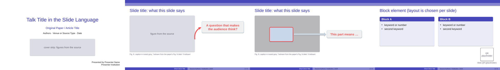

<div align="center">

# 📑 paper-sharing-skills

**Claude skills for sharing research papers, from collecting a paper's material to presenting it to a room.**

Project folder + asset collection with source attribution · audience-first paper-discussion decks (PPTX or Canva) · progressive builds only where reasoning needs them · precise highlight frames · arrows from every callout · time budgeted by key points, not page count.


**English** · [繁體中文](README.zh-TW.md)

</div>

---

Every skill in this repo follows one principle: **everything serves audience understanding.** When a situation is not covered by a rule, Claude asks *"does doing this make it easier for the audience to understand?"* — and if not, it does not do it. The rules are judgment tools, not a template to apply by default.

Works in **Claude Code**, **claude.ai** and the **Claude desktop app**.

## ✨ What it does

📁 One folder per paper · 🔗 Every asset sourced · 🙋 Ask only when necessary · 🎯 Problem first · 🪜 Builds only when needed · 🟥 Precise frames · ➡️ Arrows to callouts · 📖 Terms spelled out · ⏱️ Time by key points · 🎬 Videos & QR codes · 🌍 Any language

<details>
<summary><b>What each one means →</b></summary>

<br>

- **📁 One folder per paper.** `paper-project-setup` creates a tidy, self-describing project folder (`source/`, `figures/`, `videos/`, `posters/`, `data/`, `screenshots/`) with a README and a `manifest.json`.
- **🔗 Every asset sourced.** Each figure, video, chart dataset and screenshot is recorded in the manifest with its type, label, source URL and how it was obtained — so slide captions can credit it correctly.
- **🙋 Ask only when necessary.** Claude tries direct download, released files (GitHub / Hugging Face) and browser extraction before asking you for anything — and when it must ask, the request is precise enough to finish in one pass. Uncollectable items go into a `missing` list.
- **🎯 Problem first.** Every deck opens by defining the problem the paper solves, before any method.
- **🪜 Progressive builds only when needed.** A concept is split into build slides *by subtraction* only when it needs step-by-step reasoning — never by default.
- **🟥 Precise highlight frames.** Red frames are aligned to the exact region of the figure they point at, verified from page renders.
- **➡️ Arrows to callouts.** Every callout is connected by an arrow to the thing it explains; boxes fit their text and the text is large.
- **📖 Terms spelled out.** Every term gets its full name and a plain explanation on first use.
- **⏱️ Time by key points.** The time budget comes from the number of key points and the length of each slide's full script, not from page count.
- **🎬 Videos & QR codes.** Helpers embed demo videos that autoplay and loop, QR codes (e.g., Slido), real bullets, diverging bar charts and centred callouts.
- **🌍 Any language.** Skills are written in English; slides and speaker notes come out in whatever language you ask for.

</details>

---

## 🧩 Skills

| Skill | What it does | Version |
| --- | --- | :---: |
| [`paper-project-setup`](skills/paper-project-setup/SKILL.md) | Sets up a project folder for one paper or topic and collects its media (PDF, figures, demo videos, chart data, screenshots) with source attribution: downloads automatically where possible (direct, released files, browser), asks only for what truly cannot be fetched, and keeps a typed manifest of every asset plus a missing list. | v0.2.1 |
| [`paper-discussion-slides`](skills/paper-discussion-slides/SKILL.md) | Designs paper-discussion / journal-club decks (PPTX or Canva) that put audience understanding first. Ships a reference template deck, a `chrome()` helper for template header / footer, and a render checker for page renders, thumbnail sheets and footer zoom strips. | v0.2.0 |

More paper-sharing skills will be added over time.

### How they fit together

```mermaid
flowchart LR
    A["📄 Paper link<br/>or title"] --> B["paper-project-setup<br/>folder + assets + manifest"]
    B --> C["paper-discussion-slides"]
    C --> D1["Define the problem"]
    D1 --> D2["Plan key points<br/>+ time budget"]
    D2 --> D3["One concept per slide<br/>+ full script"]
    D3 --> D4["Progressive builds<br/>where needed"]
    D4 --> D5["Check frames, terms,<br/>callouts, timing"]
    D5 --> E["🎤 Deck + speaker notes"]
```



If the paper has no project folder yet, Claude runs `paper-project-setup` first, then follows the slide workflow.

---

## 📸 Sample template

The slide skill ships a reference deck ([`sample-template.pptx`](skills/paper-discussion-slides/assets/sample-template.pptx)) showing the layout rules in practice: cover page, figure with an arrowed question callout, a precisely aligned red frame with its explanation, and a block element with a Slido QR placeholder.

[](skills/paper-discussion-slides/assets/sample-template-preview.png)

Bring your own template instead — Claude reads its header / footer layout and draws it with `chrome()`.

---

## 🚀 Install

### Claude Code

```bash
/plugin marketplace add whats2000/paper-sharing-skills
/plugin install paper-sharing-skills@paper-sharing-skills
```

### Claude desktop app / claude.ai

Download `paper-sharing-skills.plugin` from [Releases](../../releases) and install it in Claude, or upload any folder under `skills/` as an individual skill.

> [!NOTE]
> The helper scripts use only the Python standard library plus `python-pptx` for decks. `ffmpeg` is used for video shrinking and poster frames, and Pillow (optional) for image checks.

---

## 💬 Usage

Just describe what you need:

- *"Make a 30-minute discussion deck for this paper; the audience is students interested in robotics."*
- *"Build journal club slides for this paper using my template (attached)."*
- *"Set up a folder for this paper and collect the figures and demo videos from its project page."*
- *"幫我做這篇論文的讀書會簡報，用繁體中文，20 分鐘。"*

<details>
<summary><b>Helper scripts Claude uses under the hood →</b></summary>

<br>

**`asset_tools.py`** — project folder maintenance (standard library only):

```text
init    <dir> --title T [--url U ...]       create folder layout, README.md and manifest.json
add     <dir> <file> --type T --label L --source URL --obtained HOW
missing <dir> "what" --source URL --reason R
shrink  <video> [--width 1280] [--crf 28]   write <name>_small.mp4 (needs ffmpeg)
posters <video> --at 0.1 0.5 0.9            extract still frames (needs ffmpeg)
check   <dir>                               verify every manifest file exists and opens
```

**`slide_kit.py`** — python-pptx helpers: `chrome()` (template header / title / footer), `callout()`, `frame()`, `arc_arrow()`, `block_arrow()`, `bullets()`, `hbars()`, `video()`, `qr()`, `notes()`, `dim()` / `hide()` for progressive builds.

**`render_check.py`** — page renders, a thumbnail sheet and a footer zoom strip, so frames and alignment are checked visually rather than assumed.

</details>

---

## 📂 Repository layout

```
.
├── .claude-plugin/
│   ├── plugin.json                  # plugin metadata
│   └── marketplace.json             # lets Claude Code install this repo as a marketplace
└── skills/
    ├── paper-project-setup/
    │   ├── SKILL.md                 # folder layout, collection routes, manifest
    │   ├── references/              # browser extraction snippets
    │   └── scripts/asset_tools.py   # init / add / shrink / posters / check
    └── paper-discussion-slides/
        ├── SKILL.md                 # core rules (Claude reads this first)
        ├── references/              # detailed examples, template spec example, PPTX techniques
        ├── assets/                  # sample-template.pptx (reference deck) + preview
        └── scripts/
            ├── slide_kit.py              # python-pptx helpers, incl. chrome()
            ├── build_sample_template.py  # rebuilds assets/sample-template.pptx
            └── render_check.py           # page renders, thumbnail sheet, footer zoom strip
```

---

## 🛠️ Adding a skill

1. Create a folder under `skills/` with a kebab-case name (e.g., `paper-reading-notes`).
2. Add a `SKILL.md` that starts with YAML frontmatter:
   ```markdown
   ---
   name: paper-reading-notes
   description: In the third person, say what the skill does and when to use it, including phrases a user might say.
   ---
   ```
3. Write the body as instructions for Claude. Put long examples and specifications in `references/` and code in `scripts/`.
4. Add the skill to the table above and bump the version in `.claude-plugin/plugin.json` and `marketplace.json`.

> [!TIP]
> Keep the same principle for new skills: every rule should answer *"does this make it easier for the audience or reader to understand?"*

---

## 📚 Citation

If these skills help your talks or research, please cite them:

```bibtex
@software{paper_sharing_skills,
  author  = {Ren-Di, Wu},
  title   = {{paper-sharing-skills: Audience-First Claude Skills for Sharing Research Papers}},
  year    = {2026},
  url     = {https://github.com/whats2000/paper-sharing-skills},
  version = {0.3.0}
}
```

---

## 📄 License

[MIT](LICENSE) — © whats2000.
